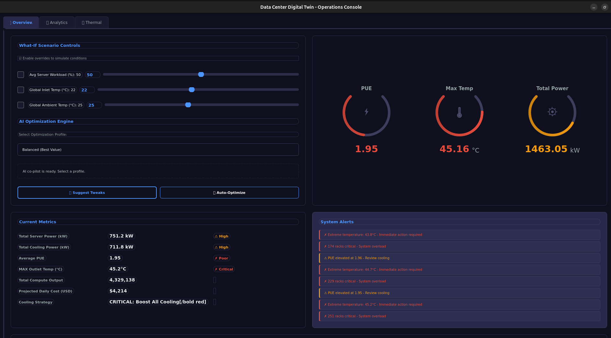
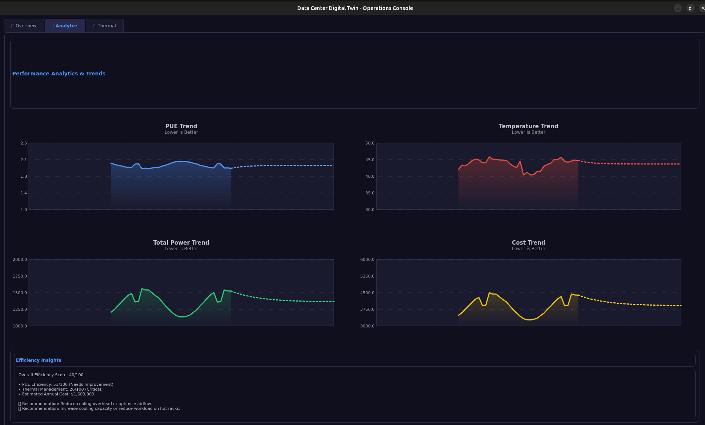
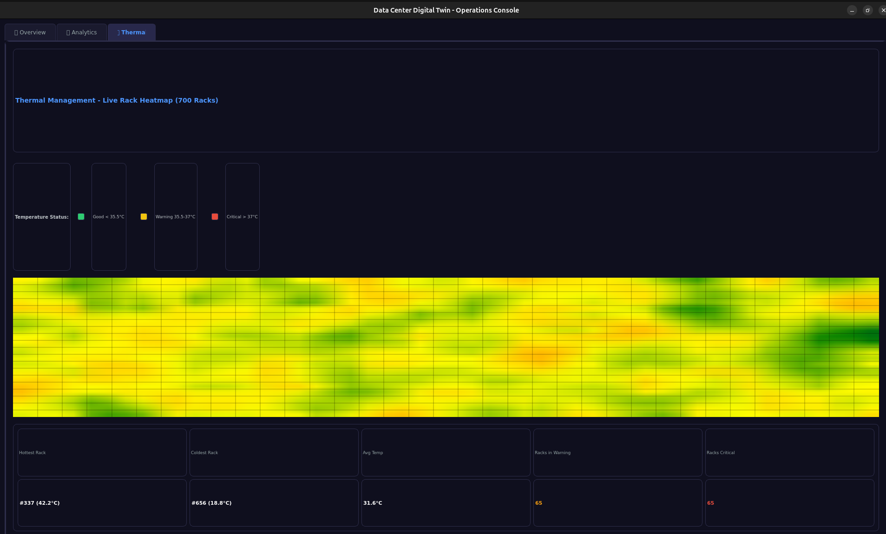

# Data Center Digital Twin

A sophisticated Python-based simulation tool for data center operations, featuring real-time physics modeling, machine learning optimization, and interactive visualization.


## Screenshots

### Main Dashboard


### Analytics View


### Thermal Heatmap


## Features

- **Physics-Based Simulation**: Realistic thermal dynamics, power consumption, and cooling system modeling
- **AI-Powered Optimization**: Machine learning for anomaly detection, forecasting, and intelligent recommendations
- **Interactive Dashboard**: Real-time PyQt5 GUI with metrics, charts, heatmaps, and controls
- **What-If Scenarios**: Adjust workload, temperature, and cooling parameters to explore outcomes
- **Predictive Analytics**: ARIMA-based forecasting for power, temperature, and cost trends
- **Smart Optimization**: AI co-pilot with three optimization profiles (Greedy, Balanced, Sustainable)
- **Custom Datasets**: Support for custom data center telemetry data integration

## Use Cases

- **Capacity Planning**: Simulate different workload scenarios before deployment
- **Energy Optimization**: Find optimal settings to reduce power consumption
- **Thermal Management**: Analyze cooling efficiency and prevent hotspots
- **Cost Analysis**: Predict operational costs under various conditions
- **Anomaly Detection**: Identify unusual operating patterns
- **Training & Education**: Learn data center operations in a safe environment

## Quick Start

### Option 1: Docker (Recommended)

Works on Windows, macOS, and Linux with minimal setup.

```bash
# Clone the repository
git clone https://github.com/yourusername/Data-Center-Digital-Twin.git
cd Data-Center-Digital-Twin

# Build and run with Docker
docker compose build
docker compose up
```

**Detailed instructions**: See [README-DOCKER.md](README-DOCKER.md)

### Option 2: Native Installation

For Python developers who require native performance and direct environment control.

```bash
# Clone the repository
git clone https://github.com/yourusername/Data-Center-Digital-Twin.git
cd Data-Center-Digital-Twin

# Create virtual environment
python -m venv venv
source venv/bin/activate  # On Windows: venv\Scripts\activate

# Install dependencies
pip install -r requirements.txt

# Initialize database
python init_db.py

# Train optimizer models (takes 2-3 minutes)
python train_optimizer.py

# Run the application
python what_if_engine.py
```

## Installation Methods Comparison

| Method | Audience | Advantages | Disadvantages |
|--------|----------|------------|---------------|
| **Docker** | General users, cross-platform | Easy setup, consistent environment | Requires X server for GUI |
| **Native** | Python developers | Native performance, easier debugging | Manual dependency management |

## System Requirements

- **OS**: Windows 10+, macOS 10.14+, or Linux (Ubuntu 18.04+)
- **RAM**: 4GB minimum, 8GB recommended
- **CPU**: 2+ cores recommended
- **Disk**: 2GB free space
- **Python**: 3.7+ (for native installation)
- **Docker**: 20.10+ (for Docker installation)

## Using Custom Datasets

The Digital Twin supports custom data center telemetry data.

### 1. Prepare Your Dataset

Create a JSON file with the following structure:

```json
[
  {
    "meta_data": {
      "entityId": "server-001"
    },
    "payload": {
      "ambient_temp_c": 25.0,
      "inlet_temp_c": 22.0,
      "server_workload_percent": 65.0
    }
  }
]
```

### 2. Place in Data Directory

```
Data-Center-Digital-Twin/
├── data/
│   └── datacenter_full_state_list.json  # Your dataset
```

### 3. Run the Application

The application automatically detects and loads the dataset.

**Full specification**: See [DATASET-FORMAT.md](DATASET-FORMAT.md)

### Validate Your Dataset

```bash
# Using Docker
docker compose run datacenter-twin python validate_dataset.py /data/datacenter_full_state_list.json

# Using Python
python validate_dataset.py data/datacenter_full_state_list.json
```

## Application Overview

### Dashboard Overview

The application features three main views:

1. **Overview**: Real-time metrics, control panel, and summary statistics
2. **Analytics**: Trend charts for power, PUE, temperature, and cost
3. **Thermal**: Detailed heatmap of server temperatures

### Control Panel

Adjust simulation parameters in real-time:

- **Ambient Temperature**: External temperature affecting cooling
- **Inlet Temperature**: Cooling system target temperature
- **Server Workload**: Computational load percentage

### AI Optimization

Three optimization profiles are available:

- **Greedy**: Maximize compute performance (ignoring cost)
- **Balanced**: Optimize compute-per-dollar (default)
- **Sustainable**: Minimize energy cost

**Controls:**
- **Suggest**: Get AI recommendations
- **Auto-Optimize**: Apply AI recommendations automatically

## Architecture

```
┌─────────────────────────────────────────────────────────┐
│                    PyQt5 GUI Layer                      │
│  (Dashboard, Charts, Controls, Visualizations)          │
└─────────────────────────────────────────────────────────┘
                          │
┌─────────────────────────────────────────────────────────┐
│              What-If Engine Controller                  │
│  (Orchestrates simulation, ML, and UI updates)          │
└─────────────────────────────────────────────────────────┘
                          │
        ┌─────────────────┴─────────────────┐
        │                                   │
┌───────────────────┐              ┌───────────────────┐
│  Digital Twin     │              │   ML Engine       │
│  Physics Engine   │              │                   │
│  • Thermal Model  │              │  • Anomaly Det.   │
│  • Power Model    │              │  • Forecasting    │
│  • Cooling Model  │              │  • Optimization   │
└───────────────────┘              └───────────────────┘
        │                                   │
┌───────────────────────────────────────────────────────┐
│              Data Pipeline & Storage                  │
│  • Scenario Combinator  • Data Ingestor               │
│  • SQLite Database      • State Randomizer            │
└───────────────────────────────────────────────────────┘
```

## Project Structure

```
Data-Center-Digital-Twin/
├── data/                          # Dataset directory
│   ├── datacenter_full_state_list.json
│   └── sample.json
├── db/                            # SQLite database
├── models/                        # Trained ML models
├── ui/                            # PyQt5 GUI components
│   ├── main_window.py
│   └── dashboard_widgets.py
├── twin/                          # Physics engine
│   └── digital_twin_engine.py
├── simulation/                    # Simulation dynamics
│   └── dynamics.py
├── ingest/                        # Data ingestion
├── what_if_engine.py             # Main application
├── ml_engine.py                  # ML/AI engine
├── data_pipeline.py              # Data processing
├── train_optimizer.py            # Model training
├── init_db.py                    # Database setup
├── validate_dataset.py           # Dataset validator
├── requirements.txt              # Python dependencies
├── Dockerfile                    # Docker image
├── docker-compose.yml            # Docker orchestration
├── README-DOCKER.md              # Docker guide
└── DATASET-FORMAT.md             # Dataset specification
```

## Configuration

### Environment Variables

Create a `.env` file for configuration:

```bash
# Display settings (for Docker)
DISPLAY=:0

# Qt settings
QT_X11_NO_MITSHM=1

# Application settings
PYTHONUNBUFFERED=1
```

### Customizing ML Models

Edit `train_optimizer.py` to adjust:
- Number of training samples
- Model parameters (n_estimators, max_depth)
- Feature engineering

## Development

### Running Tests

```bash
# TODO: Add test suite
pytest tests/
```

### Code Style

```bash
# Format code
black .

# Lint
flake8 .
```

### Contributing

1. Fork the repository
2. Create a feature branch (`git checkout -b feature/amazing-feature`)
3. Commit your changes (`git commit -m 'Add amazing feature'`)
4. Push to the branch (`git push origin feature/amazing-feature`)
5. Open a Pull Request

## Documentation

- **[Docker Installation Guide](README-DOCKER.md)**: Complete Docker setup for all platforms
- **[Dataset Format Specification](DATASET-FORMAT.md)**: How to prepare custom datasets
- **[API Documentation](docs/API.md)**: Code documentation (TODO)
- **[User Guide](docs/USER-GUIDE.md)**: Detailed usage instructions (TODO)

## Troubleshooting

### Common Issues

**GUI doesn't appear:**
- Ensure X server is running (XQuartz on macOS, VcXsrv on Windows)
- Check `DISPLAY` environment variable
- See platform-specific guides in [README-DOCKER.md](README-DOCKER.md)

**"Optimizer models not found":**
- Run `python train_optimizer.py` to train models
- Or rebuild Docker image: `docker compose build --no-cache`

**High memory usage:**
- Reduce dataset size
- Limit Docker resources in docker-compose.yml

**Dataset not loading:**
- Validate format: `python validate_dataset.py data/your_dataset.json`
- Check file name: must be `datacenter_full_state_list.json`
- See [DATASET-FORMAT.md](DATASET-FORMAT.md)

## Support

- **Issues**: [GitHub Issues](https://github.com/yourusername/Data-Center-Digital-Twin/issues)
- **Discussions**: [GitHub Discussions](https://github.com/yourusername/Data-Center-Digital-Twin/discussions)
- **Email**: your.email@example.com

## License

This project is licensed under the GNU General Public License v3.0 - see the [LICENSE](LICENSE) file for details.

## Acknowledgments

- PyQt5 for the GUI framework
- scikit-learn for machine learning
- statsmodels for time series forecasting
- Docker for containerization
